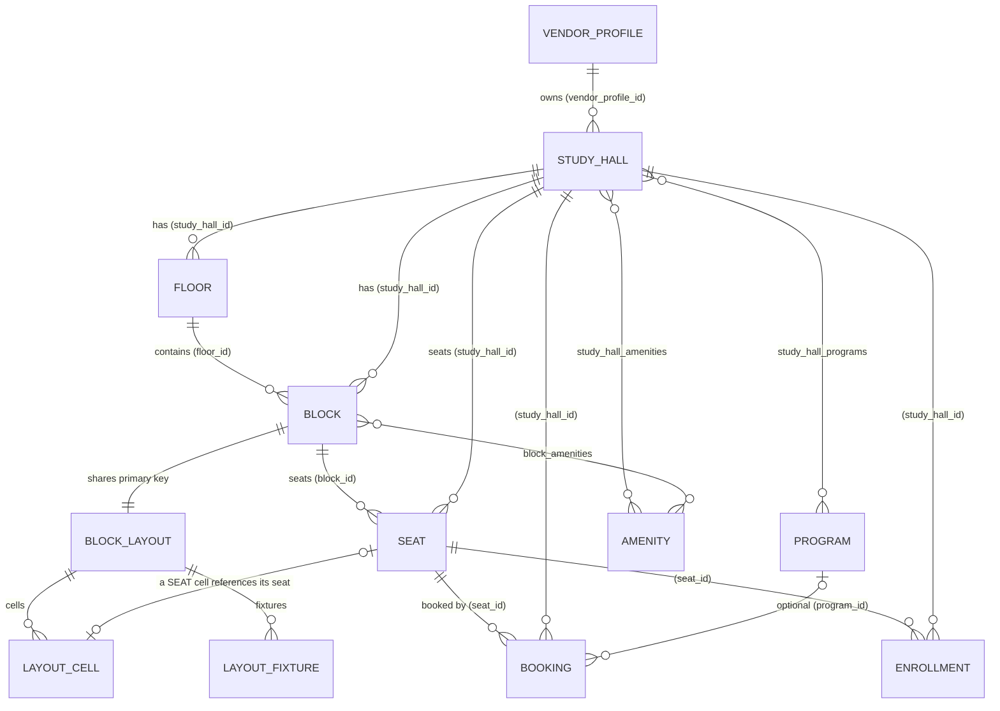

# SPACZ Backend — Technical Study Guide

> Scope: the active backend in this folder, `spacz-platform/` (five Spring Boot services) and the
> `spacz-partner-service/` folder. Every statement below was checked against the source files named in
> it. Where a fact could not be confirmed from the code that was read, the text says
> **Not determinable from the provided code.** Secrets are never reproduced; they appear as
> `[SECRET / ENVIRONMENT VARIABLE]`.
>
> Files I did **not** analyse in depth are listed in §2.4 and §19. This document is a study guide, not a
> line-by-line audit.

---

## 1. Backend overview

### 1.1 What the backend does (simple terms)

SPACZ is a marketplace for **study halls** (libraries where students rent a seat by the day or the month).
The backend answers five kinds of questions:

| Question | Answered by |
|---|---|
| "Who is this person and are they allowed in?" | **auth-service** (phone OTP and password login, tokens) |
| "What does this student's profile look like?" | **user-service** (profile, exams, documents, feedback) |
| "Which halls exist, what do their seats look like, can I book a seat?" | **studyhall-service** (the core: halls, layouts, seats, bookings, enrollments) |
| "Approve this vendor / hall, show dashboards, publish offers" | **admin-service** |
| "Route every request to the right place" | **gateway-service** |

A vendor (hall owner) designs a hall's seating plan. A student searches halls, looks at a live seat map for
chosen dates and books one seat. The booking then becomes an enrollment, and the vendor sees it.

### 1.2 Architecture in plain words

```
Phone / web app
      │  HTTPS, one address only (port 8080)
      ▼
┌──────────────────────────────┐
│ gateway-service  (8080)       │  checks token shape, routes by URL path, adds request IDs
└──────────────────────────────┘
   │          │           │            │
   ▼          ▼           ▼            ▼
 auth      user       studyhall     admin
 (8081)    (8082)      (8083)       (8084)
   │          │           │            │
  PostgreSQL databases — one per service, nothing shared:
  spacz_auth   spacz_user   spacz_studyhall   spacz_admin
```

Two rules hold the design together:

1. **Each service owns its data.** No service reads another service's database. When one needs data from another,
   it calls that service over HTTP on `/internal/**` (see §9.4).
2. **Every service checks the token itself.** The gateway rejects obviously bad tokens early, but each service
   verifies the signature, expiry and issuer again (`JwtDecoderConfig` in each service). The gateway's own comment
   calls this "defence in depth only".

### 1.3 Technology stack (from the code)

| Area | Technology | Where it is set |
|---|---|---|
| Language | Java 17 | `spacz-studyhall-service/Dockerfile` (`eclipse-temurin:17`) |
| Framework | Spring Boot **3.4.2** | `spacz-studyhall-service/pom.xml` (parent) |
| Gateway | Spring Cloud Gateway (WebFlux, reactive) | `spacz-gateway-service` (`GatewaySecurityConfig` uses `@EnableWebFluxSecurity`) |
| Persistence | Spring Data JPA / Hibernate, PostgreSQL 16 | `docker-compose.yml` (`postgres:16-alpine`), `application.yml` (`ddl-auto: validate`) |
| Schema versioning | Flyway, migrations `V1`–`V11` | `spacz-studyhall-service/src/main/resources/db/migration/` |
| Security | Spring Security OAuth2 Resource Server, JWT (HS256) | each service's `security/` package |
| Passwords | BCrypt, strength 12 | `spacz-auth-service/.../JwtEncoderConfig.java` (bean `passwordEncoder`) |
| API docs | springdoc OpenAPI / Swagger UI | `OpenApiConfig` in each service; aggregated by the gateway |
| Legacy database | MySQL 8.4 (used by the legacy migration only) | `docker-compose.yml` |
| Build | Maven (`pom.xml`, wrapper `mvnw`) | each service folder |

### 1.4 How a request flows (summary; detail in §18)

```
HTTP request
 → gateway: correlation ID added, body size limited (2 MB), token signature/expiry/issuer checked, path → service
 → service: JWT re-verified, role checked (URL rule, then @PreAuthorize), body validated (@Valid)
 → controller: maps the request to a service method
 → service: business rules, transaction, repository calls
 → repository → Hibernate → PostgreSQL
 → entity → DTO (response record) → JSON
```

---

## 2. Project structure

### 2.1 Top level (`D:\Spacz_backend`)

```
Spacz_backend/
├── spacz-platform/          ← the active platform (5 services, details below)
├── spacz-partner-service/   ← older partner (vendor) service, see §2.4
├── spacz/                   ← older monolith (SETUP.md, BACKEND_DOCUMENTATION.md), see §2.4
├── __MACOSX/                ← zip-extraction artefact; not code
└── (no top-level README)
```

### 2.2 Inside `spacz-platform/`

```
spacz-platform/
├── README.md                 ← the authoritative platform overview (ports, DBs, flows)
├── docker-compose.yml        ← starts PostgreSQL, MySQL (legacy) and all five services
├── docs/
│   ├── ARCHITECTURE.md       ← design notes written alongside the code
│   ├── FRONTEND_INTEGRATION.md
│   └── MIGRATION_PLAN.md
├── postman/                  ← Postman collection
├── docker/                   ← database initialisation (not read in depth)
├── scripts/                  ← e.g. legacy-migration (moves MySQL data)
├── spacz-gateway-service/
├── spacz-auth-service/
├── spacz-user-service/
├── spacz-studyhall-service/
└── spacz-admin-service/
```

### 2.3 Standard layout of each service (Maven)

Every service uses the same package layout. This is the main thing to learn once:

```
spacz-<service>/src/main/java/com/spacz/<service>/
├── <App>Application.java    ← Spring Boot entry point (@SpringBootApplication)
├── config/                  ← @ConfigurationProperties, clocks, OpenAPI, bootstrap, correlation filter
├── security/                ← Spring Security: filter chains, JWT decoding, role mapping, error bodies
├── controller/              ← HTTP entry points (@RestController). Thin: no business rules
│   └── internal/            ← service-to-service endpoints, protected by an API key
├── dto/                     ← request and response records (what goes over HTTP)
│   └── <topic>/             ← DTOs grouped by feature (e.g. dto/seat, dto/booking)
├── entity/                  ← JPA entities (database tables) and enums (state values)
├── repository/              ← Spring Data repositories (+ *Specifications for dynamic filters)
├── service/                 ← interfaces (the contract used by controllers)
│   └── impl/                ← implementations (the business logic, @Transactional)
│   └── support/             ← pure helpers (parsers, numbering, pricing maths)
├── mapper/                  ← entity → DTO conversion (Entity is never sent out directly)
├── client/                  ← HTTP clients to other services (internal API)
├── exception/               ← ApiError body, exception types, @RestControllerAdvice handler
├── audit/  (where present)  ← audit events forwarded to admin-service
└── storage/ (user, studyhall) ← file storage for images and documents
```

Why these folders exist: each layer has **one reason to change**. A new endpoint touches `controller` and
maybe `dto`. A new business rule touches `service/impl`. A new column touches `entity` and a migration.
Keeping them apart is what makes the code reviewable.

### 2.4 Folders and projects that were inventoried, not analysed

| Item | What was checked | Status |
|---|---|---|
| `spacz-partner-service/` | README and controller list (Amenity, Block, Image, Owner, Property, Seat) | Its README says the functionality **moved** into studyhall-service (the legacy Partner API is served there, `LegacyPartnerService`). Treat as legacy. |
| `spacz/` (monolith) | Controller list (Amenity, AspirantUser, Auth, Block, Image, Owner, Property, Seat), `BACKEND_DOCUMENTATION.md` | Legacy. Its README says it is kept "until you sign off". |
| `spacz-platform/docker/`, `scripts/legacy-migration` | Names only | Not read in depth. |
| `spacz-platform/docs/*.md` | Names only | Not read in depth; `ARCHITECTURE.md` was used only as a cross-check idea. |
| Test sources (§17) | Names and class-level purpose | Bodies not read. |

---

## 3. Services and their responsibilities

| Service | Port | Database | Owns | Main packages |
|---|---|---|---|---|
| gateway-service | 8080 | none | routing, CORS, early JWT checks, correlation IDs, Swagger aggregation | `gateway/config`, `gateway/filter`, `gateway/security` |
| auth-service | 8081 | `spacz_auth` | accounts, phone OTP, passwords, JWT issuing, refresh tokens, lockouts | `auth/controller`, `auth/service`, `auth/entity`, `auth/security` |
| user-service | 8082 | `spacz_user` | student profile, exam/course choices, activity, documents, feedback | `user/controller`, `user/service`, `user/storage` |
| studyhall-service | 8083 | `spacz_studyhall` | vendor profiles, halls, floors, blocks, layouts, seats, amenities, programs, bookings, enrollments | `studyhall/controller`, `studyhall/service`, `studyhall/entity` |
| admin-service | 8084 | `spacz_admin` | admin profiles, dashboard, approvals, audit log, offers, platform updates | `admin/controller`, `admin/service` |

Ports and databases are taken from `spacz-platform/README.md` and each service's `application.yml`.

---

## 4. Gateway

### 4.1 Simple explanation

The gateway is the only door. It decides, from the URL path, which service should answer, and it refuses
requests that cannot possibly be valid. It does not store anything.

### 4.2 Routes (`spacz-gateway-service/src/main/resources/application.yml`)

| Route id | Path predicate | Sent to |
|---|---|---|
| `auth-service` | `/api/auth/**` | auth-service |
| `user-service` | `/api/users/**` | user-service |
| `studyhall-service` | `/api/vendors/**`, `/api/studyhalls/**`, `/api/programs/**`, `/api/amenities/**`, `/api/bookings/**` | studyhall-service |
| `studyhall-legacy-partner-api` | `/api/owners/**`, `/api/properties/**`, `/api/blocks/**`, `/api/seats/**`, `/amenities/**`, `/images/**` | studyhall-service (legacy Partner app contract) |
| `admin-service` | `/api/admin/**` | admin-service |
| `admin-content` | `/api/offers/**`, `/api/notifications/**` | admin-service (student-facing content) |
| `*-docs` (4 routes) | `/docs/<svc>/v3/api-docs` | each service's OpenAPI document |

The downstream addresses come from environment variables (`AUTH_SERVICE_URL`, `USER_SERVICE_URL`,
`STUDYHALL_SERVICE_URL`, `ADMIN_SERVICE_URL`), with defaults to `localhost:8081`–`8084`.

### 4.3 Gateway classes

| File | Purpose | Important detail |
|---|---|---|
| `config/GatewayProperties.java` | Binds `spacz.gateway.*` (JWT secret, issuer, CORS origins) | The secret is `[SECRET / ENVIRONMENT VARIABLE]` |
| `config/CorsConfig.java` | CORS for the web clients | Origins from `CORS_ALLOWED_ORIGINS` |
| `filter/CorrelationIdFilter.java` | Adds `X-Correlation-Id` to request and response | Keeps a client-supplied ID if well formed; highest precedence |
| `filter/RequestLoggingFilter.java` | Logs requests | Global filter |
| `security/GatewaySecurityConfig.java` | The access rules at the edge (§9.2) | `@EnableWebFluxSecurity`, `ReactiveJwtDecoder` with HS256 and issuer validation |

### 4.4 Gateway defaults (from `application.yml`)

- `RemoveRequestHeader=X-Internal-Api-Key`: clients can never inject the internal key.
- `RequestSize maxSize: 2MB`: larger bodies are refused before they reach a service.
- Timeouts: connect 3 s, response 20 s.
- Health (`/actuator/health`) and OpenAPI paths are the only public management endpoints.

---

## 5. Controllers (inventory)

### 5.1 What a controller is (concept)

A controller is the HTTP entry point. It reads the request (URL, query parameters, body, the logged-in user),
calls one service method and returns the result as JSON. **It should contain no business rules.**

Annotations used in this project:

| Annotation | Meaning |
|---|---|
| `@RestController` | A class whose methods return data (JSON), not view names. |
| `@RequestMapping("/api/x")` | The base path for the class. |
| `@GetMapping` / `@PostMapping` / `@PutMapping` / `@PatchMapping` / `@DeleteMapping` | HTTP method plus a path for one method. |
| `@PathVariable` | Takes a value from the URL, e.g. `/{id}`. |
| `@RequestParam` | Takes a query parameter, e.g. `?status=ACTIVE`. |
| `@RequestBody` | Parses the JSON body into a DTO. |
| `@Valid` | Runs the validation annotations on that DTO (§12). |
| `@AuthenticationPrincipal` | Injects the caller (`AuthenticatedUser`: `userId`, `email`, `role`) from the verified token. |
| `@PreAuthorize("hasRole('VENDOR')")` | Method-level role check, enabled by `@EnableMethodSecurity`. |
| `ResponseEntity<T>` | Explicit control over status code and headers. Used for file downloads and some creates. |

### 5.2 Public and authenticated endpoints (studyhall-service)

Source: `StudyHallController`, `SeatingController`, `BookingController`, `EnrollmentController`,
`VendorController`, `ProgramController`, `AmenityController`.

| Method | Path | Controller method | Auth / role | Purpose |
|---|---|---|---|---|
| GET | `/api/studyhalls` | `search` | public | Search ACTIVE halls (§9.5) |
| GET | `/api/studyhalls/locations` | `locations` | public | Cities with live halls |
| GET | `/api/studyhalls/{id}` | `get` | public | Hall detail |
| GET | `/api/studyhalls/{id}/availability` | `availability` | public | Seats free today |
| GET | `/api/studyhalls/{id}/layout` | `layout` (SeatingController) | public | Full layout + per-date seat availability |
| GET | `/api/studyhalls/{id}/seats` | `seats` (SeatingController) | authenticated | Seat map (rows of seats) |
| POST | `/api/studyhalls` | `create` | VENDOR | Create a draft hall |
| PUT | `/api/studyhalls/{id}` | `update` | VENDOR | Edit a hall |
| DELETE | `/api/studyhalls/{id}` | `delete` | VENDOR | Delete a hall |
| POST | `/api/studyhalls/{id}/submit` | `submit` | VENDOR | Send for approval |
| PATCH | `/api/studyhalls/{id}/status` | `changeStatus` | VENDOR | Visibility change |
| PUT | `/api/studyhalls/{id}/operating-hours` | `operatingHours` | VENDOR | Opening hours |
| POST | `/api/studyhalls/{id}/images/upload` | `uploadImage` | VENDOR | Multipart photo upload |
| GET | `/api/studyhalls/media/{hallId}/{file}` | `media` | public | Serves a stored hall image |
| POST | `/api/studyhalls/{id}/amenities` | `addAmenities` | VENDOR | Attach amenities |
| GET / POST | `/api/studyhalls/{id}/floors`, `/blocks`, `/seats` … | SeatingController | VENDOR | Floors, blocks, layouts, seats (§10) |
| POST | `/api/bookings/quote` | `quote` | USER | Price for a seat and dates, without holding it |
| POST | `/api/bookings` | `create` | USER | Hold a seat (status PENDING) |
| GET | `/api/bookings/me` | `mine` | USER | My bookings, optional status filter |
| GET | `/api/bookings/{id}` | `get` | owner / vendor | One booking |
| POST | `/api/bookings/{id}/confirm` | `confirm` | USER | Confirm a held booking (§15.3) |
| POST | `/api/bookings/{id}/cancel` | `cancel` | USER | Cancel |
| GET / POST / PATCH | `/api/studyhalls/{id}/enrollments` … | EnrollmentController | VENDOR | Students (enrollments) of a hall |
| GET | `/api/studyhalls/{id}/bookings` | `bookings` | VENDOR | Hall bookings |
| GET | `/api/vendors/me` (+ PUT, `/submit`, `/studyhalls`, `/students`, `/bookings`) | VendorController | VENDOR | Vendor profile and dashboard lists |
| POST | `/api/vendors` | `create` | VENDOR | Create vendor profile |
| GET | `/api/vendors/{vendorId}` | `publicProfile` | public | Public vendor card |
| GET | `/api/programs` | `list` | public | Exam/course catalogue |
| GET | `/api/programs/all` | `all` | ADMIN | Catalogue including inactive |
| POST/PUT/DELETE | `/api/programs` | `create`/`update`/`delete` | ADMIN | Maintain catalogue |
| GET | `/api/amenities` | — | public | Amenities catalogue (admin writes, §9.2) |

Legacy Partner endpoints (`LegacyPartnerService`) live under `/api/owners`, `/api/properties`,
`/api/blocks`, `/api/seats`, `/amenities`, `/images` (role VENDOR). Their contract is kept unchanged for the old
Partner app.

### 5.3 Other services (inventory)

| Service | Controllers | Key endpoints |
|---|---|---|
| auth-service | `AuthController` | `POST /api/auth/register`, `/register/user`, `/register/vendor`, `/login`, `/otp/request`, `/otp/verify`, `/refresh`, `/logout`; `GET /api/auth/me`; `PUT /api/auth/me/password`. Internal: `InternalAccountController` (`/internal/accounts`). |
| user-service | `UserController`, `UserDocumentController`, `FeedbackController` | `GET/PUT /api/users/me`, `GET/POST/PUT/DELETE /api/users/me/programs…`, `GET /api/users/me/enrollments`, `GET /api/users/me/activity`, `GET/PUT /api/users/me/documents/{type}` (multipart) and `/file`, `POST/GET /api/users/me/feedback`. Admin/internal reads under `/api/users/{userId}…` and `/internal/users`. |
| admin-service | 11 admin controllers + `StudentContentController` | `/api/admin/dashboard`, `/api/admin/studyhalls` (`/{id}/approve|reject|suspend|activate`), `/api/admin/vendors`, `/api/admin/users`, `/api/admin/bookings`, `/api/admin/offers`, `/api/admin/updates`, `/api/admin/audit-logs`, `/api/admin/me`. Public: `GET /api/offers`, `GET /api/notifications`. Internal: `/internal/offers`, `/internal/audit-events`. |
| gateway-service | none | routing only |

Full endpoint-by-endpoint detail for these three services was not read; their route names above are taken
from the `@RequestMapping` and `@GetMapping`/`@PostMapping` annotations.

---

## 6. DTO layer

### 6.1 Concept

A **DTO** (Data Transfer Object) is the shape of data that crosses the HTTP boundary. An **entity** is the
shape of a database row plus its relationships. They are kept apart because:

- **Security:** an entity may hold `passwordHash`, `failedLoginAttempts`, internal IDs. A DTO exposes only
  what the caller may see.
- **Stability:** the database can change without breaking the API.
- **Validation:** request DTOs carry the rules that apply to input (§12).

### 6.2 How DTOs are written in this project

Java **records** (immutable, short). Request DTOs carry validation annotations; response DTOs have none.
Examples checked:

| DTO | Direction | Notable fields / rules |
|---|---|---|
| `auth/dto/LoginRequest` | in | `email`, `password` (validated by `@Valid`) |
| `auth/dto/OtpRequest` | in | `phone` (normalised by `PhoneNumbers.normalize`) |
| `auth/dto/OtpVerifyRequest` | in | `phone`, `code`, optional `role` (USER/VENDOR) and registration fields |
| `auth/dto/AuthResponse` | out | `accessToken`, `refreshToken`, `tokenType`, `expiresIn`, `account` |
| `auth/dto/OtpRequestResponse` | out | masked phone, TTL, resend cooldown, `devCode` only when exposure is on |
| `studyhall/dto/booking/CreateBookingRequest` | in | `studyHallId`, `seatId`, `plan`, `startDate`, `endDate` or `months`, optional `programId` (`effectivePlan()`, `effectiveEndDate()` derive values) |
| `studyhall/dto/booking/BookingResponse` | out | reference, seat, plan, dates, units, unit price, base amount, discount, platform charges, taxes, total, status, hold expiry |
| `studyhall/dto/seat/LayoutResponse` | out | `layoutType`, `rows`, `columns`, `version`, `cells` (every position), `fixtures` |
| `studyhall/dto/seat/FixtureResponse` | out | fixture `type` (AC), `position` (edge or CENTER), `offset`, `direction`, `label` |
| `studyhall/exception/ApiError` | out | `timestamp`, `status`, `error` (code), `message`, `path`, `correlationId`, `fieldErrors` |

### 6.3 Mapping

Entity → DTO conversion is done in `mapper/` classes (for example `studyhall/mapper/BookingMapper`,
`SeatMapper`, `EnrollmentMapper`, `StudyHallMapper`, `LegacyMapper`). Mapping is done in code, not with a
mapping library. `auth/mapper/AccountMapper` builds the account block of the auth response.

---

## 7. Service layer

### 7.1 Concept

A service holds the **business rules**: "a seat can only be booked for dates that do not overlap an existing
PENDING or CONFIRMED booking", "a vendor can only edit their own hall", "a refresh token can be used once".
A service is marked `@Service`. Methods that change data are marked `@Transactional`, so all the database
writes of one method commit together or not at all.

Why not in the controller: controllers are reached over HTTP; services are also reached from scheduled jobs and
other services. Rules placed in controllers would be bypassed by the job, and could not be unit-tested without HTTP.

### 7.2 Important services

**auth-service** (`auth/service/impl`)

| Class | Responsibility | Calls / produces |
|---|---|---|
| `OtpServiceImpl` | Issue and verify phone codes (§9.3) | `OtpChallengeRepository`, `SmsSender`, `UserServiceClient`, `StudyHallServiceClient`, `TokenService` |
| `AuthServiceImpl` | Password login, register user/vendor, refresh with reuse detection, logout, change password | `UserAccountRepository`, `RefreshTokenRepository`, `TokenService`, `PasswordEncoder` |
| `TokenServiceImpl` | Mint the access JWT and the refresh token | `JwtEncoder` (HS256), `RefreshTokenRepository` (stores a SHA-256 hash) |
| `AccountManagementServiceImpl` | Admin-side account status changes | repositories |
| `RefreshTokenCleanupJob` | Scheduled removal of expired refresh tokens | `RefreshTokenRepository` |
| `OtpServiceImpl.purgeOldChallenges` | `@Scheduled` cron (default `0 15 * * * *`) deleting challenges older than a day | `OtpChallengeRepository` |

**studyhall-service** (`studyhall/service/impl`)

| Class | Responsibility | Calls / produces |
|---|---|---|
| `BookingServiceImpl` | Quote, hold, confirm, cancel, list, expire holds, complete finished bookings (§15.2) | `SeatRepository`, `BookingRepository`, `ProgramRepository`, `BookingPricing`, `EnrollmentService`, `UserServiceClient`, event publisher |
| `BookingPricing` | Price a stay: base × units, best live offer, platform fee, tax | `AdminServiceClient.liveOffers()`; if admin is down the booking is priced **without** an offer |
| `BookingLifecycleJob` | `@Scheduled(fixedDelayString = ${spacz.booking.lifecycle-interval-ms:60000}, initialDelay = 30000)` → `expireHolds`, `completeFinished`, end enrollments | `BookingService` |
| `SeatingServiceImpl` | Floors, blocks, layouts, seats, seat moves, facings, fixtures (§10) | `FloorRepository`, `BlockRepository`, `BlockLayoutRepository`, `SeatRepository`, `LayoutTemplateParser`, `BlockLayouts` |
| `StudyHallManagementServiceImpl` | Vendor-side hall lifecycle: create (DRAFT), update, submit for approval, images, amenities, programs, hours | `VendorAccess`, repositories |
| `StudyHallAdminServiceImpl` | Admin search and `applyAction` (approve / reject / suspend / activate) | repositories, admin audit |
| `StudyHallQueryServiceImpl` | Public search, detail and availability | `StudyHallSpecifications` |
| `EnrollmentServiceImpl` | Walk-in and booking-derived enrollments of a hall | `EnrollmentRepository` |
| `VendorServiceImpl` | Vendor profile create/update/submit | `VendorProfileRepository` |
| `LegacyImportServiceImpl`, `LegacyPartnerServiceImpl` | Import from the old MySQL monolith; the legacy Partner API | repositories |
| `HallImageService` | Stores hall photos on disk | `storage/LocalHallImageStorage` |

**user-service** (`user/service/impl`): `UserProfileService`, `UserProgramService`, `ActivityService`,
`FeedbackService`, `EnrollmentQueryService`, `UserDocumentService` (impl). `UserDocumentServiceImpl` checks the
file size against `storageProperties.maxFileBytes()` and stores the bytes through `DocumentStorage`
(implemented by `LocalDocumentStorage`).

**admin-service**: `AccountServiceImpl`-style services per area (`BookingAdminServiceImpl`,
`DashboardServiceImpl`, `StudyHallModerationServiceImpl`, `UserAdminServiceImpl`, `VendorAdminServiceImpl`).
Read in part only — see §2.4.

### 7.3 Example: how one service method flows

`BookingServiceImpl.create(userId, request)`:

```
BookingController.create ──► BookingServiceImpl.create
  1 validateDates(plan, start, end, today)            (rules: no past dates, end ≥ start, max 90 days …)
  2 seatRepository.findByIdForUpdate(seatId)          (row lock — concurrent bookings of the same seat queue)
  3 bookableUnitPrice(seat, hallId, plan)             (price comes from the seat/block, never from the client)
  4 programRepository.findById → must be active
  5 bookingRepository.expireStaleHolds(...)           (old unpaid holds for this seat are released)
  6 checkAvailability(userId, seat, start, end, now)  (overlap query + one-booking-per-hall-per-student rule)
  7 Booking.hold(reference, userId, seat, …, holdExpiresAt = now + 15 min)
  8 booking.applyPricing(pricing.price(...))          (admin offer lookup; fallback if admin is down)
  9 if autoConfirm → confirm                          (default: false)
 10 saveAndFlush → DB exclusion constraint may reject → ConflictException SEAT_UNAVAILABLE
 11 publish event; if CONFIRMED → enrollmentService.recordConfirmedBooking
 12 mapper.toResponse(booking) → BookingResponse
```

---

## 8. Repository and database layer

### 8.1 Concept

A **repository** is the interface to a table. Spring Data JPA generates the implementation from the interface
at startup. A method named `findByUserIdAndStatus` becomes a query with no SQL written. Complex filters use
**Specifications** (`*Specifications.java`), which build a `WHERE` clause from optional parts.

**JPA/Hibernate** maps Java objects to rows. **Lazy loading** (`FetchType.LAZY`) means related rows are only
loaded when touched. `spring.jpa.open-in-view: false` (set in every service) stops the database session from
staying open during JSON rendering, which avoids accidental queries from the view layer.

### 8.2 Repositories in studyhall-service (checked)

| Repository | Notable methods (from the code) | Why it exists |
|---|---|---|
| `SeatRepository` | `findByIdForUpdate` (pessimistic lock) | Serialise concurrent bookings of one seat |
| `BookingRepository` | `expireStaleHolds(...)`, `existsOverlapping(seatId, start, end, OCCUPYING)`, `existsUserOverlap(...)`, `findByUserId`, `findByUserIdAndStatus`, `findExpiredHolds(...)`, `findFinished(...)`, `findDetailed(id)` | Availability and lifecycle queries |
| `BookingSpecifications` | `overlapping(from, to)` and status/hall filters | Vendor and admin booking lists |
| `StudyHallSpecifications` | ACTIVE halls whose vendor is APPROVED or ACTIVE (`cb.equal(root.get("status"), ACTIVE)`) | The public search rule |
| `VendorSpecifications`, `ProgramSpecifications` | filtered lists | Admin and catalogue lists |
| `BlockLayoutRepository`, `FloorRepository`, `BlockRepository`, `EnrollmentRepository`, `ProgramRepository`, `AmenityRepository`, `StudyHallRepository`, `VendorProfileRepository` | standard Spring Data + specific finders | One per aggregate |

### 8.3 Repositories in the other services (checked by name)

- **auth**: `UserAccountRepository` (`findByPhone`, `findByEmail`, `UserAccountSpecifications`),
  `OtpChallengeRepository` (`findLatestOpenForUpdate`, `consumeAllOpen`, `countByPhoneAndCreatedAtAfter`,
  `deleteCreatedBefore`), `RefreshTokenRepository` (`findByTokenHashForUpdate`, `revokeAllActive`).
- **user**, **admin**: one repository per table (not read in depth).

### 8.4 Transactions

- Write methods are `@Transactional` at the service level.
- `OtpServiceImpl.verify` uses `noRollbackFor = InvalidCredentialsException.class`: a wrong code **must commit**
  the failed-attempt counter. Without this, an attacker could guess forever.
- `TokenServiceImpl.issueTokens` uses `Propagation.MANDATORY`: it can only run inside a transaction started by its
  caller, so a token is never issued for a half-saved account.
- `BookingServiceImpl.create` relies on the database to reject overlaps (§15.2) even if application checks pass.

---

## 9. Security

### 9.1 Concepts

- **Authentication**: "who are you?" — proven by a signed token.
- **Authorization**: "may you do this?" — a role or ownership check.
- **JWT** (JSON Web Token): a signed string with claims (`sub`, `exp`, custom claims). Verifying the signature
  proves the server issued it and it was not changed. This project uses **HS256** (HMAC with a shared secret).
- **Filter chain**: Spring Security runs a list of filters on each request; the first to reject ends it.

### 9.2 Gateway access rules (`GatewaySecurityConfig`, in order)

1. `OPTIONS` → permit (CORS preflight).
2. `/internal/**` → **deny** (never reachable from outside).
3. Health, Swagger and `/docs/**` → permit.
4. `POST` to `/api/auth/register*`, `/login`, `/refresh`, `/logout`, `/otp/request`, `/otp/verify` → permit.
5. `GET` to `/api/studyhalls/**`, `/api/programs/**`, `/api/amenities/**`, `/api/vendors/*`, `/api/offers` → permit.
6. `/api/admin/**` → `ROLE_ADMIN`; `/api/programs/**` and `/api/amenities/**` writes → `ROLE_ADMIN`.
7. Legacy partner paths and `/api/vendors/**` → `ROLE_VENDOR`.
8. `/api/users/**` → `ROLE_USER` or `ROLE_ADMIN`.
9. Any other `/api/**` → authenticated. Anything else → deny.

The gateway's JWT decoder uses the shared secret, HS256, and `JwtValidators.createDefaultWithIssuer(...)`. The
role claim `role` is mapped to `ROLE_<ROLE>`; the principal is `userId`.

### 9.3 OTP authentication (auth-service, `OtpServiceImpl`)

```
POST /api/auth/otp/request {phone}
  normalise phone (PhoneNumbers.normalize, default country code from config)
  reject if a code was issued less than the resend cooldown ago           → 429 OTP_TOO_SOON
  reject if more than maxPerHour codes issued in the last hour            → 429 OTP_RATE_LIMITED
  consume every open challenge for this phone
  code = random digits (SecureRandom), length from config
  store OtpChallenge(phone, hash, expiresAt, requesterIp)
     hash = HMAC-SHA256(key = JWT secret, data = "phone:code")   ← see §9.6 review point
  smsSender.send(phone, "Your SPACZ code is …")
  respond {maskedPhone, ttl, resendCooldown, devCode only if exposure enabled}

POST /api/auth/otp/verify {phone, code, [role, firstName, lastName, city, businessName, …]}
  load latest open, usable challenge (not expired, attempts < maxAttempts)  → 422 "invalid or expired"
  compare hash with MessageDigest.isEqual (constant time)
      wrong → registerFailedAttempt() (committed), 422
  account for phone?
      none and no role given → 422 REGISTRATION_REQUIRED (code is NOT consumed; client retries with role)
      none and role given   → register (USER: calls user-service; VENDOR: calls studyhall-service)
      exists                → ensureActive(account) (suspended/locked refused)
  challenge.consume(now)                                                   (single use)
  account.registerSuccessfulLogin(now)
  tokenService.issueTokens(account) → {accessToken, refreshToken, expiresIn, account}
```

The frontend implements exactly this two-step registration (`src/services/auth.service.ts`): it calls verify,
receives `REGISTRATION_REQUIRED`, shows the registration form, and repeats verify with the same code plus
`role: 'USER'` and the name.

### 9.4 Token issuing and refresh (auth-service, `TokenServiceImpl`, `AuthServiceImpl.refresh`)

- **Access token**: JWT, HS256, claims `iss` (issuer), `sub` (account id), `iat`, `exp` (default lifetime from
  `AuthProperties.accessTokenTtl`), `jti` (random), `userId`, `role`, `email` (if set), `phone` (if set).
- **Refresh token**: 32 random bytes, Base64URL. Only its **SHA-256 hash** is stored (`RefreshToken.issue`).
- **Rotation**: `refresh()` looks up the hash with a row lock. A token already rotated is treated as theft:
  `revokeAllActive(accountId)` logs the account out everywhere and logs a warning.
- Logout revokes the presented refresh token.

### 9.5 Passwords and lockout

- Stored as **BCrypt, strength 12** (`JwtEncoderConfig.passwordEncoder`).
- Password rule: 8–72 characters (BCrypt limit), at least one letter and one digit (`ValidationPatterns`).
- Login with an unknown email still runs `matches` against a dummy hash, so response time does not reveal which
  emails exist (`AuthServiceImpl.login`, line ~140).
- Failed logins are counted (`failedLoginAttempts`); after `maxFailedLogins` the account is locked until
  `lockedUntil` (`UserAccount`). Exact numbers are configuration, not read.

### 9.6 Authorization inside services

- URL rules are coarse (who may call at all).
- `@PreAuthorize("hasRole('VENDOR')")` on controller methods checks the role.
- **Ownership** is checked in services: for example `VendorAccess.writableHall(vendorId, studyHallId)` and
  `BookingServiceImpl.get` (owner or the hall's vendor). `user/security/OwnershipGuard` is the user-service
  equivalent.

### 9.7 Internal (service-to-service) calls

`InternalApiKeyFilter` (in each service's `security/`) reads `X-Internal-Api-Key` and compares it with the
configured key in **constant time**. It is attached only to the `/internal/**` filter chain
(`SecurityConfig`, `@Order(1)`), and it is deliberately not a Spring bean, so it cannot run on other paths. The
gateway removes this header from client requests (`RemoveRequestHeader`) and denies `/internal/**`.

Internal endpoints (checked): `studyhall`: `/internal/bookings`, `/internal/enrollments`, `/internal/programs/lookup`,
`/internal/stats`, `/internal/import/vendors`, `/internal/import/bookings`, `/internal/studyhalls`,
`/internal/vendors`. `auth` → `/internal/accounts`. `user` → `/internal/users`. `admin` → `/internal/offers`,
`/internal/audit-events`.

Callers (checked by `grep`): auth-service's `UserServiceClient`, `StudyHallServiceClient`, `AdminServiceClient`
and `AuditEventForwarder`; studyhall-service's `AdminServiceClient` (live offers, audit) and `UserServiceClient`
(`findUsers`); admin-service's `UserServiceClient` and `StudyHallServiceClient`. All clients extend
`BaseServiceClient`, which sends the header and applies the timeouts (connect 2 s, read 5 s).

### 9.8 Security flow (end to end)

```
Client
 ↓  Authorization: Bearer <jwt>
Gateway (GatewaySecurityConfig)
 ↓  signature (HS256), expiry, issuer, route rule, role prefix
Service (SecurityConfig, filter chain)
 ↓  JwtDecoder re-verifies; JwtClaimsConverter builds AuthenticatedUserToken (userId, role)
Controller (@PreAuthorize)
 ↓  role again
Service (ownership check)
 ↓
Repository
```

### 9.9 Review points (honest observations from the code)

1. **The OTP SMS sender logs the message.** `LoggingSmsSender` is the default (`sms-provider` matches
   missing ⇒ `log`) and writes `[DEV SMS] to <phone>: <message>` — the message contains the code. No real SMS
   provider exists in the code read. Production needs a real `SmsSender` and the log must not contain codes.
2. **The OTP HMAC key is the JWT signing secret.** `OtpServiceImpl.hash` uses `securityProperties.jwt().secret()`.
   Rotating the JWT secret invalidates outstanding codes; and compromise of one secret affects both.
3. `expose-code-in-response` defaults to `false` (good); it is documented as development only.

---

## 10. Study hall, seats and layouts (studyhall-service)

### 10.1 Concept

A hall has **floors**; a floor has **blocks** (sections, e.g. "AC Reading Hall"); a block has a **layout**: a
grid of rows × columns where each position is a seat, a walkway, an entrance, an AC unit, etc. Seats are real
records with a number and a price; grid cells that are not seats are "features".

### 10.2 Entities

| Entity (table) | Key fields | Relationships (verified) |
|---|---|---|
| `StudyHall` (`study_halls`) | name, address, prices, `status: StudyHallStatus`, approval timestamps | `@ManyToOne vendor → VendorProfile` (`vendor_profile_id`); `@OneToMany` images, operatingHours, blocks, floors, seats/enrollments; `@ManyToMany` amenities (`study_hall_amenities`) and programs (`study_hall_programs`) |
| `VendorProfile` (`vendor_profiles`) | business name, contact, `VendorStatus` | referenced by halls |
| `Floor` (`floors`) | floorNumber (0 ground, >0 upper, <0 basement), name, displayOrder | `@ManyToOne studyHall` (`study_hall_id`); `@OneToMany blocks` |
| `Block` (`blocks`) | name, totalRows, totalColumns, prices (override hall prices), displayOrder | `@ManyToOne studyHall`, `@ManyToOne floor` (`floor_id`); `@ManyToMany amenities` (`block_amenities`); `@OneToMany seats` |
| `BlockLayout` (`block_layouts`) | layoutType, rows, columns, version | `@OneToOne block` (shares the block's primary key); `@OneToMany cells`, `@OneToMany fixtures` |
| `Seat` (`seats`) | seatNumber, rowIndex, columnIndex, seatType, status, prices, direction | `@ManyToOne studyHall` and `@ManyToOne block` (`block_id`) |
| `LayoutCell` (`layout_cells`) | rowIndex, columnIndex, `LayoutCellType`, label, direction | `@ManyToOne layout` (cascade delete); `@ManyToOne seat` (only for SEAT cells) |
| `LayoutFixture` (`layout_fixtures`) | `FixtureType` (AC), `FixturePosition` (edge/CENTER), offset, direction, label | `@ManyToOne layout` (cascade delete). Takes **no grid position** (V8) |
| `Booking` (`bookings`) | bookingReference, userId, plan, startDate, endDate, status, prices, offer, holdExpiresAt | `@ManyToOne studyHall`, `@ManyToOne seat`, `@ManyToOne program` (nullable). `userId` is a plain number: **no foreign key to another service** |
| `Enrollment` (`enrollments`) | status (ACTIVE/COMPLETED/CANCELLED), source, dates, student info | `@ManyToOne studyHall`, `@ManyToOne program`, `@ManyToOne seat` |
| `Program` (`programs`) | code, name, active flag | referenced by enrollments and bookings |
| `Amenity` (`amenities`) | name, code | `@ManyToMany` with halls and blocks |
| `OperatingHours`, `StudyHallImage` | per-day hours; photo metadata | `@ManyToOne studyHall` |

Enums: `StudyHallStatus` = DRAFT, PENDING_APPROVAL, APPROVED, REJECTED, SUSPENDED, ACTIVE, INACTIVE.
`BookingStatus` = PENDING, CONFIRMED, CANCELLED, COMPLETED, EXPIRED (`OCCUPYING` = PENDING, CONFIRMED).
`EnrollmentStatus` = ACTIVE, COMPLETED, CANCELLED. `LayoutCellType` includes SEAT, WALKWAY, ENTRANCE, EXIT,
TABLE, WALL, PILLAR, RECEPTION, STAIRS, LIFT, RESTROOM, AC, OTHER (AC is a legacy cell type; new writers use
fixtures).

### 10.3 Relationship diagram (only relations present in the code)



Not in the diagram, because the code has no such relation: `Booking.userId` → user (another database, plain
number); `Booking`/`Enrollment` → auth accounts.

### 10.4 Layout rules enforced in code

- `BlockLayout.addSeat` requires the position to be inside the grid and free (`requireFree`).
- Unique constraints in the database: one cell per position per layout; one cell per seat (`uk_layout_cells_*`).
- Shrinking the grid is refused while any cell lies outside it.
- Fixtures are validated against the grid (`LayoutFixture.of`): an edge offset must be inside the edge; CENTER
  takes no offset.
- Direction is validated per type (`Direction.requireValidFor`): only directional types have a direction; only
  AC may be CENTER.
- Maximum grid 60 × 60 (`Block.MAX_GRID`); `max-layout-cells: 2500` (configuration).

### 10.5 Seat numbering

`SeatNumbering` produces numbers from a block prefix and a counter (for example `GA-12`). Persisted seats keep
their number; new seats continue after the block's highest number (see `SeatingServiceImpl` seat creation).

### 10.6 How a layout is created and read

- **Create block with a template**: `POST /api/studyhalls/{id}/blocks` with a `layoutTemplate` text. The
  `LayoutTemplateParser` reads line 1 as row A (the entrance side), one token per column (`.` empty, `s` seat,
  `TYPE` or `TYPE:label` feature, `@N/@S/@E/@W/@C` direction). Seats are generated from `s` tokens.
- **Save an existing block** (vendor app): `PUT /blocks/{id}/layout` with `features`, `fixtures`,
  `seatMoves`, `seatDirections`. `updateLayout` first calls `layout.clearFeatures()` (removes **all** non-seat
  cells) and then re-adds the submitted features — so a save without AC cells removes legacy AC cells.
- **Read for students**: `GET /api/studyhalls/{id}/layout?startDate&endDate` → `HallLayoutResponse`: every
  position of every block (`cells`), the block's `fixtures`, and per seat an `available` flag computed for the
  requested dates.

---

## 11. Vendor flow (studyhall-service, VendorController / StudyHallController)

1. `POST /api/vendors` — create the vendor profile (or the auth-service calls the internal
   `POST /internal/vendors` during registration).
2. `POST /api/studyhalls` — hall created in **DRAFT**.
3. Floors / blocks / layouts / seats via `SeatingController` (§10).
4. `POST /api/studyhalls/{id}/submit` — `submitForApproval(approvalRequired, now)`:
   - when `approvalRequired` is true (default `STUDYHALL_APPROVAL_REQUIRED=true`) → **PENDING_APPROVAL**;
   - a hall whose vendor is already operational can go straight to the next state (`StudyHall.java`, around
     line 199: APPROVED → ACTIVE when the vendor is operational).
5. Admin decides (admin-service `AdminStudyHallController`): `POST /api/admin/studyhalls/{id}/approve|reject|suspend|activate`.
6. Public visibility: only **ACTIVE** halls whose vendor is APPROVED or ACTIVE appear in search
   (`StudyHallSpecifications`).

The exact transition table is in `StudyHall.java` and `StudyHallStatus`; only the lines quoted above were read.
**Full transition table: Not determinable from the code I read.**

---

## 12. Booking flow and payment (studyhall-service)

### 12.1 Steps

| # | Step | Endpoint | Class / method | Result |
|---|---|---|---|---|
| 1 | Choose hall and dates | `GET /api/studyhalls/{id}/layout?startDate&endDate` | `SeatingController.layout` | seat availability for the dates |
| 2 | Price a seat | `POST /api/bookings/quote` | `BookingServiceImpl.quote` | price breakdown, nothing saved |
| 3 | Hold a seat | `POST /api/bookings` | `BookingServiceImpl.create` | booking **PENDING**, `holdExpiresAt = now + 15 min` |
| 4 | Confirm (post-payment step) | `POST /api/bookings/{id}/confirm` | `BookingServiceImpl.confirm` | **CONFIRMED** |
| 5 | Enrolment | (automatic) | `EnrollmentServiceImpl.recordConfirmedBooking` | enrollment ACTIVE |
| — | Cancel | `POST /api/bookings/{id}/cancel` | `BookingServiceImpl.cancel` | CANCELLED |
| — | Hold expiry | scheduled | `BookingLifecycleJob` → `expireHolds` | EXPIRED |
| — | Finish | scheduled | `completeFinished` | COMPLETED; enrollment ends |

### 12.2 Why there is no double booking

Three layers, in order:
1. **Row lock**: `findByIdForUpdate` on the seat — two requests for the same seat run one after another.
2. **Application check**: `checkAvailability` (overlap query over PENDING/CONFIRMED) and the per-student rule
   (`existsUserOverlap`).
3. **Database rule**: `V3__booking_overlap_constraint.sql`:
   `EXCLUDE USING gist (seat_id WITH =, daterange(start_date, end_date, '[]') WITH &&) WHERE status IN ('PENDING','CONFIRMED')`.
   A `DataIntegrityViolationException` becomes `ConflictException("SEAT_UNAVAILABLE")` (HTTP 409).

### 12.3 Pricing

`BookingPricing.price`: `base = unitPrice × units`; the best applicable live offer from admin-service
(`firstBookingOnly` respected) gives `discount`; `taxable = base − discount + platformFee`; `taxes` on taxable;
`total = taxable + taxes`. The result is stored on the booking (`V9__booking_price_breakdown.sql`). The
platform fee and tax rates are configuration (`PricingProperties`, not read).

### 12.4 Payment — what the code actually does

**There is no payment gateway in the code read.** No Razorpay, Stripe or similar integration exists in the
studyhall, user, auth or admin services. The only payment-related state is the booking status: a hold is
PENDING, and `POST /api/bookings/{id}/confirm` moves it to CONFIRMED. Whether that endpoint is called after a
real payment is decided by the client (the frontend calls it from its "Pay Now" action). **Payment provider
integration: Not determinable from the provided code.**

`BOOKING_AUTO_CONFIRM` (default `false`) would skip the confirm step.

---

## 13. Error handling

### 13.1 Concept

Every failure should return the same JSON shape with a machine-readable `error` code, so the app can show the
right message. Java exceptions are translated centrally by a `@RestControllerAdvice`.

### 13.2 The error body

`studyhall/exception/ApiError` (identical design in the other services):

```json
{
  "timestamp": "2026-09-25T10:15:30Z",
  "status": 409,
  "error": "SEAT_UNAVAILABLE",
  "message": "Seat G-12 is already booked for some of the selected dates",
  "path": "/api/bookings",
  "correlationId": "6f1c2a0e-…",
  "fieldErrors": [ { "field": "startDate", "message": "…" } ]
}
```

`@JsonInclude(NON_EMPTY)` leaves out empty fields. The gateway's own errors (401/403) use the same keys.

### 13.3 Exception types

| Type | HTTP | Used for |
|---|---|---|
| `SpaczException` (base) | given by the instance | any error with a custom code |
| `BusinessRuleException` | 422 (default) | rule violations (e.g. `INVALID_DATE_RANGE`, `PLAN_NOT_OFFERED`, `INVALID_LAYOUT_CELL`) |
| `ResourceNotFoundException` | 404 | missing seat, hall, booking |
| `DuplicateResourceException` | 409 | duplicate |
| `ConflictException` | 409 | `SEAT_UNAVAILABLE`, `DUPLICATE_BOOKING` |
| `ForbiddenException` | 403 | not your hall |
| `ServiceUnavailableException` | 503 | a dependent service is down |

Handler methods in `studyhall/exception/GlobalExceptionHandler` (checked): `SpaczException`,
`MethodArgumentNotValidException` (400 `VALIDATION_ERROR` with `fieldErrors`), `HandlerMethodValidationException`,
`ConstraintViolationException`, `MethodArgumentTypeMismatchException`, missing parameters/headers (400),
`HttpMessageNotReadableException` (400 `MALFORMED_REQUEST`), `HttpRequestMethodNotSupportedException` (405),
`HttpMediaTypeNotSupportedException` (415), `NoResourceFoundException` (404).

### 13.4 Security errors

`security/SecurityErrorHandlers` and the gateway's `writeError` return 401 `UNAUTHORIZED` ("Access token is
missing, invalid or expired") and 403 `FORBIDDEN`.

### 13.5 How errors reach the app

The HTTP status and the `error` code travel to the frontend. `src/services/api.ts` turns a non-2xx response into
`ApiError(status, code, message, fieldErrors, correlationId)`, and `errorMessage()` produces a user message
(401 → "session expired", 413 → "file too large", 5xx → server error, 4xx → the backend's message).

---

## 14. Validation

Bean Validation annotations on request DTOs (counts from a `grep` across the four main services):

| Annotation | Files using it | Typical use |
|---|---|---|
| `@NotNull` | 39 | required fields (ids, enums, dates) |
| `@NotBlank` | 34 | required text (names, phone, code) |
| `@NotEmpty` | 3 | required lists |
| `@Size` | 49 | length limits (names, reference codes, passwords 8–72) |
| `@Pattern` | 16 | formats (phone, password rule via `ValidationPatterns`) |
| `@Email` | 10 | email fields |
| `@Min`, `@Max`, `@Positive` | 18, 7, 2 | numbers (grid size, page size, prices) |
| `@Valid` | 37 | triggers validation of a nested DTO or a request body |

Validation runs before the service method. Failures become `400 VALIDATION_ERROR` (§13.3). Business validation
(dates, availability, ownership) is done in services and is **not** expressed as annotations.

**Rule order** (from `SecurityConfig`): role checks come before body validation, so a wrong role gets 403, not 400.

---

## 15. Configuration

### 15.1 Files

Each service has `src/main/resources/application.yml` (no `.properties` files were found). The studyhall file
imports the platform `.env` when run outside Docker (`spring.config.import: optional:file:../.env[.properties]`).

### 15.2 Important settings (studyhall-service, names and defaults)

| Setting | Default in file | Meaning |
|---|---|---|
| `server.port` | `${SERVER_PORT:8083}` | HTTP port |
| `spring.datasource.url` | `${DB_URL:jdbc:postgresql://localhost:…/spacz_studyhall}` | database |
| `spring.datasource.username` / `password` | `${DB_USERNAME:spacz_studyhall}` / `[SECRET / ENVIRONMENT VARIABLE]` | database login |
| `spring.datasource.hikari.maximum-pool-size` | `${DB_POOL_SIZE:15}` | connection pool |
| `spring.jpa.open-in-view` | `false` | no lazy loading in views |
| `spring.jpa.hibernate.ddl-auto` | `validate` | Flyway owns the schema |
| `spring.flyway.locations` | `classpath:db/migration` | migrations V1–V11 |
| `spring.servlet.multipart.max-file-size` | `2MB` | upload limit |
| `spacz.security.jwt.secret` | `[SECRET / ENVIRONMENT VARIABLE]` | must equal auth-service's signing secret |
| `spacz.security.jwt.issuer` | `${JWT_ISSUER:spacz-auth}` | expected `iss` claim |
| `spacz.security.internal.api-key` | `[SECRET / ENVIRONMENT VARIABLE]` | service-to-service key |
| `spacz.studyhall.approval-required` | `${STUDYHALL_APPROVAL_REQUIRED:true}` | halls need admin approval |
| `spacz.booking.hold-duration` | `${BOOKING_HOLD_DURATION:15m}` | how long a PENDING seat is held |
| `spacz.booking.auto-confirm` | `${BOOKING_AUTO_CONFIRM:false}` | skip the confirm step |
| `spacz.booking.max-days` / `max-advance-days` | `90` / `90` | booking window |
| `spacz.booking.zone` | `${BUSINESS_TIME_ZONE:Asia/Kolkata}` | "today" for bookings |
| `spacz.storage.hall-images-dir` | `${HALL_IMAGES_DIR:./data/hall-images}` | photo folder |
| `spacz.clients.*` | `USER_SERVICE_URL`, `ADMIN_SERVICE_URL` | downstream URLs, timeouts 2 s / 5 s |
| `management.endpoints.web.exposure.include` | `health,info` | only these actuator endpoints |
| `logging.pattern.level` | `%5p [service,correlationId]` | correlation ID in every log line |

Auth-service (checked): `spacz.otp.expose-code-in-response` = `${OTP_EXPOSE_CODE:false}`; SMS provider
`spacz.otp.sms-provider` (absent ⇒ `log`, §9.9).

### 15.3 Environment variables seen in configuration

`SERVER_PORT`, `DB_URL`, `DB_USERNAME`, `DB_PASSWORD` (name only), `DB_POOL_SIZE`, `POSTGRES_HOST_PORT`,
`JWT_ISSUER`, `CORS_ALLOWED_ORIGINS`, `AUTH_SERVICE_URL`, `USER_SERVICE_URL`, `STUDYHALL_SERVICE_URL`,
`ADMIN_SERVICE_URL`, `HALL_IMAGES_DIR`, `BOOKING_HOLD_DURATION`, `BOOKING_AUTO_CONFIRM`,
`STUDYHALL_APPROVAL_REQUIRED`, `BUSINESS_TIME_ZONE`, `OTP_EXPOSE_CODE`. Secret values:
`[SECRET / ENVIRONMENT VARIABLE]`.

### 15.4 CORS

Configured in the gateway (`CorsConfig`, `CORS_ALLOWED_ORIGINS`, default localhost ports 3000, 5173, 4200).
Each service also sets its own CORS policy for direct access — details **not determinable from the code I read**.

---

## 16. Docker and deployment

### 16.1 `spacz-platform/docker-compose.yml` (checked)

| Service | Image / build | Host port | Notes |
|---|---|---|---|
| `postgres` | `postgres:16-alpine` | `${POSTGRES_HOST_PORT:-5432}` | one server, multiple databases; volume `pgdata` |
| `mysql` | `mysql:8.4` | `${MYSQL_HOST_PORT:-3307}` | legacy data for migration; volume `mysqldata` |
| `user-service` | `build: ./spacz-user-service` | `8082` | volume `userdocs` (uploaded documents), depends on postgres |
| `studyhall-service` | `build: ./spacz-studyhall-service` | `8083` | volume `hallimages` (photos) |
| `auth-service` | `build: ./spacz-auth-service` | `8081` | |
| `admin-service` | `build: ./spacz-admin-service` | `8084` | |
| `gateway-service` | `build: ./spacz-gateway-service` | `8080` | the only service a client should reach |

All services share the network `spacz`. Named volumes: `pgdata`, `mysqldata`, `userdocs`, `hallimages`.

### 16.2 Dockerfile (studyhall-service, the pattern for all)

1. Build stage: `maven:3.9.9-eclipse-temurin-17`, dependency cache, `mvn package -DskipTests`.
2. Runtime stage: `eclipse-temurin:17-jre`, non-root user `spacz` (uid 1001), folder `/data/hall-images`,
   `EXPOSE 8083`, `JAVA_OPTS="-XX:MaxRAMPercentage=75 -XX:+ExitOnOutOfMemoryError"`, health check on
   `/actuator/health/readiness`, `ENTRYPOINT` runs `java -jar app.jar`.

### 16.3 Running locally

Per `spacz-platform/README.md` (Quick start, Docker): `docker compose up` from `spacz-platform/`. Without
Docker, each service can be run with `./mvnw spring-boot:run` from its folder with the matching database
available (the studyhall `application.yml` reads `../.env`). Exact commands beyond this:
**Not determinable from the code read** (the README's quick-start section was not read in full).

### 16.4 Deployment

Production hosting, CI and secret management: **Not determinable from the provided code.** The compose file
is a local/containers setup.

---

## 17. Testing

Test sources (names checked, bodies not read):

| Area | Tests |
|---|---|
| Gateway | `GatewaySecurityTest` (route and token rules) |
| Auth | `AuthFlowIntegrationTest`, `OtpAndRegistrationIntegrationTest`, `AuthServiceImplTest` |
| User | `UserApiIntegrationTest` |
| Admin | `AdminApiIntegrationTest`, `VendorAdminServiceImplTest` |
| Study hall | `StudyHallFlowIntegrationTest`, `SeatingLayoutApiTest`, `LegacyPartnerApiTest`, `HallImageUploadApiTest`, `DoubleBookingPostgresTest`, `BookingServiceImplTest` (unit), `StateMachineTest` (entity), `LayoutTemplateParserTest` (unit) |
| Support | `ApiTestSupport`, `Fixtures`, `TestTokens` per service (builds signed tokens for tests) |

- **Unit tests** call one class with mocks (e.g. `BookingServiceImplTest`, `LayoutTemplateParserTest`).
- **Integration tests** start the Spring context (`*ApiIntegrationTest`, `*FlowIntegrationTest`).
- `DoubleBookingPostgresTest` checks the exclusion constraint on real PostgreSQL — it is the only test that can prove §12.2 layer 3.
- **Swagger / OpenAPI**: every service has an `OpenApiConfig`; `springdoc` serves `/v3/api-docs` and
  `/swagger-ui.html`; the gateway aggregates them under `/docs/<service>/v3/api-docs`. The Postman collection is
  in `spacz-platform/postman/`.
- Test coverage percentage and CI: **Not determinable from the provided code.**

---

## 18. One complete request, from beginning to end

Example: a student confirms a held booking (`POST /api/bookings/{id}/confirm`).

```
Frontend (bookings "Pay Now")
 │  POST https://<gateway>/api/bookings/123/confirm
 │  Authorization: Bearer <accessToken>          (added by src/services/api.ts)
 ▼
Gateway :8080
 │  CorrelationIdFilter     → X-Correlation-Id added
 │  RequestSize 2 MB, RemoveRequestHeader X-Internal-Api-Key
 │  GatewaySecurityConfig   → token signature/expiry/issuer ✔; path /api/bookings/** → authenticated ✔
 │  route studyhall-service → http://studyhall:8083/api/bookings/123/confirm
 ▼
studyhall-service :8083
 │  SecurityConfig (apiFilterChain) → JwtDecoder ✔, JwtClaimsConverter → userId=7, role=USER
 │  URL rule: /api/bookings/** authenticated ✔
 ▼
BookingController.confirm  @PreAuthorize("hasRole('USER')") ✔
 │  calls bookingService.confirm(user.userId(), 123)
 ▼
BookingServiceImpl.confirm  @Transactional
 │  load booking (must belong to userId 7)              → ForbiddenException / ResourceNotFound otherwise
 │  booking.confirm(now)  (status PENDING → CONFIRMED; rule-checked in the entity)
 │  bookingRepository.saveAndFlush(booking)
 │  (overlap constraint still applies on commit)
 ▼
PostgreSQL spacz_studyhall: UPDATE bookings SET status='CONFIRMED' …
 ▼
Back in service: enrollment and events (BookingServiceImpl.publish)
 ▼
mapper: Booking → BookingResponse (no entity leaves the service)
 ▼
Controller returns 200 + JSON
 ▼
Gateway → frontend
 ▼
Frontend: booking.service.confirmBooking → screen updates status badge to "Paid"
```

Failure path example: seat already booked → `ConflictException("SEAT_UNAVAILABLE")` → `ApiError` 409 →
`errorMessage()` → "One of the selected seats was just taken."

---

## 19. Technical review questions

| # | Question | Answer | Why this design | Where |
|---|---|---|---|---|
| 1 | Why separate microservices instead of one app? | Each area (identity, profiles, halls/bookings, admin) has its own data and team; a failure in one does not corrupt another's data. Cost: cross-service calls and duplicated checks. | Data ownership | `spacz-platform/README.md`; §1.2 |
| 2 | Why a gateway if every service checks tokens anyway? | The gateway rejects bad requests early and is the one public address; services still verify (defence in depth). | Edge filtering plus zero trust inside | `GatewaySecurityConfig` |
| 3 | How is a double booking prevented? | Row lock, application overlap check, then a PostgreSQL exclusion constraint. | Database is the final guard | `BookingServiceImpl.create`; `V3__booking_overlap_constraint.sql`; `DoubleBookingPostgresTest` |
| 4 | Why are OTP codes hashed? | If the table leaks, codes are not readable; HMAC needs the server secret. | Stored secrets must be one-way | `OtpServiceImpl.hash` |
| 5 | Why does a wrong OTP commit a database write? | To persist the attempt counter; otherwise attempts could be unlimited. | Brute-force limit | `@Transactional(noRollbackFor = InvalidCredentialsException.class)` |
| 6 | How are refresh tokens protected? | Stored as SHA-256; rotated on each use; reuse revokes all sessions. | Limits damage from a stolen refresh token | `TokenServiceImpl`, `AuthServiceImpl.refresh` |
| 7 | Why `open-in-view: false`? | Prevents lazy loading during JSON rendering (hidden N+1 queries). | Explicit fetching in services | every `application.yml` |
| 8 | Why DTO records, not entities, in responses? | Entities hold sensitive fields; DTOs are the public contract. | Security and stable API | `dto/` packages, `mapper/` |
| 9 | Why does the layout save delete features first? | Layout cells are a replaceable set; `clearFeatures()` then re-add keeps the grid consistent with what the vendor sent. | Simple, correct replace semantics | `SeatingServiceImpl.updateLayout` |
| 10 | Where are AC units stored and why not as seats? | As **fixtures** on a block edge or centre; they take no grid position, so they cannot replace a seat. Legacy AC cells still exist in the schema. | Physical features are not bookable | `LayoutFixture`, `V8__compass_directions_and_layout_fixtures.sql` |
| 11 | How does pricing decide the discount? | Best live admin offer applied to base; falls back to no offer if admin is down. | Availability over accuracy for offers only | `BookingPricing.price` |
| 12 | Is there real payment processing? | No payment gateway in the code read; confirm is a status change. | Payment deferred | §12.4 |
| 13 | What runs on a schedule? | Booking holds expire, finished bookings complete, enrollments end, old OTP challenges and refresh tokens are purged. | Time-based state changes need a background job | `BookingLifecycleJob`, `OtpServiceImpl.purgeOldChallenges`, `RefreshTokenCleanupJob` |
| 14 | How do services call each other securely? | Internal endpoints under `/internal/**`, an API key compared in constant time, blocked at the gateway. | Internal trust without user tokens | `InternalApiKeyFilter`, `SecurityConfig` |
| 15 | Why is `Booking.userId` a plain number? | The user lives in another database; a foreign key would couple services. | Service independence | `Booking.java` |
| 16 | What is the biggest security weakness visible in the code? | OTP codes are logged by the default SMS sender, and the OTP key equals the JWT secret. | Development default, not production-ready | §9.9 |

---

## HOW TO STUDY THIS PROJECT

Read in this order:

1. §1 Overview and the architecture diagram.
2. §2 Project structure — learn the standard package layout once.
3. §3 Service responsibilities and databases.
4. §4 Gateway routes and rules.
5. §10 Entities and the ER diagram (the data is the core of the design).
6. §6 DTOs and §8 Repositories.
7. §7 Services — read `BookingServiceImpl.create` line by line.
8. §5 Controllers — match each endpoint to its service method.
9. §9 Security — OTP flow, token issuing and rotation, role checks, internal key.
10. §12 Booking flow, double-booking protection and the V3 migration.
11. §13 Errors and §14 Validation.
12. §15 Configuration and §16 Docker.
13. §18 The end-to-end request.
14. Open the code for one flow end to end (login by OTP, or booking) with the document beside it.

## IF THE REVIEWER OPENS THIS FILE, WHAT SHOULD I BE ABLE TO EXPLAIN?

- [ ] The five services, their ports and their databases, and why each owns its data.
- [ ] Why the gateway exists and what it checks before forwarding.
- [ ] How a JWT is issued, verified in each service, and rotated (refresh token and reuse detection).
- [ ] The phone-OTP flow, including the `REGISTRATION_REQUIRED` second step, and what is hashed and why.
- [ ] Controller → service → repository → database, with one real example each.
- [ ] Why DTOs and entities are separate, and where mapping happens.
- [ ] The main entities and their relationships (hall → floor → block → layout → cells/fixtures; seat ↔ booking).
- [ ] How a seat is booked: hold, overlap check, row lock, database exclusion constraint, confirm, enrollment.
- [ ] What is **not** implemented: no payment gateway; OTP SMS is logged in the default configuration.
- [ ] How errors are shaped (`ApiError`) and how validation errors appear.
- [ ] Which configuration values are environment variables and which secrets must never be committed.
- [ ] How the services run in Docker and which ports are published.
- [ ] Which scheduled jobs change state, and how often.
- [ ] Which parts of this document were verified from code and which were marked "Not determinable".
